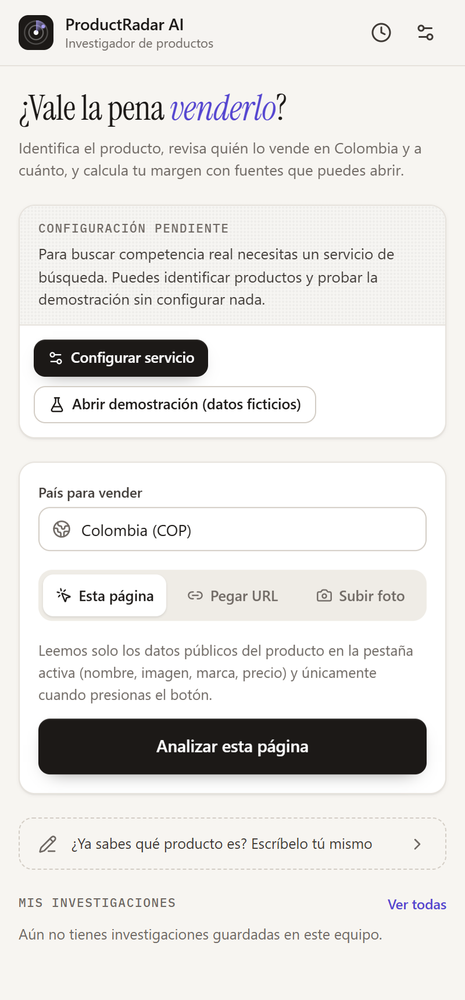
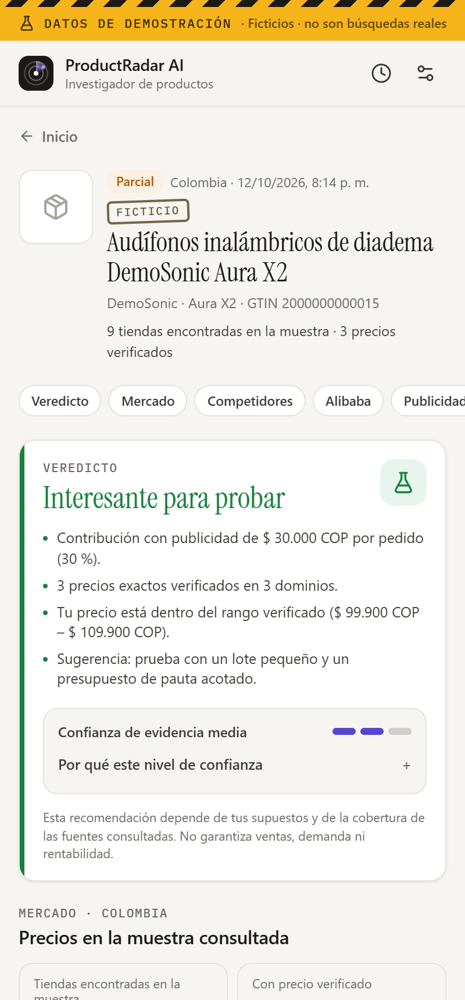
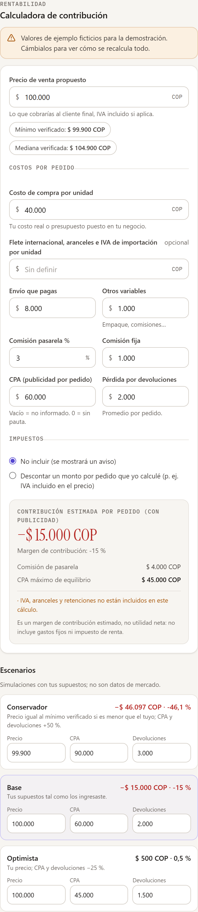

# ProductRadar AI

**Extensión de Chrome (Manifest V3) que investiga si vale la pena vender un producto.** A partir de la pestaña abierta, una URL o una foto, identifica el producto, busca quién lo vende en el país elegido y a cuánto, separa precios verificados de los que solo aparecen en el buscador, consulta referencias públicas de Alibaba, enlaza las bibliotecas oficiales de anuncios y calcula el margen de contribución con tus propios supuestos.

> «Encontré este producto. ¿Ya lo venden en Colombia? ¿A cuánto? ¿Cuánta competencia pude identificar? ¿Cuánto podría ganar por unidad? ¿Vale la pena probarlo?»

Código abierto (MIT). Sin cuentas, sin tienda propia, sin Shopify. Todo ocurre en el panel lateral de Chrome.

| Inicio | Reporte | Calculadora |
| --- | --- | --- |
|  |  |  |

Las capturas del reporte corresponden al **modo demostración (datos ficticios)**, que siempre muestra la franja «DATOS DE DEMOSTRACIÓN».

---

## Qué hace (y qué no)

**Hace**

- Lee la ficha del producto (JSON-LD de Schema.org, Open Graph, microdatos) **solo cuando presionas «Analizar»**, en la pestaña activa o en una URL que pegues.
- Identifica productos en fotos con un modelo de visión (Claude) y te deja **corregir** nombre, marca, modelo, GTIN y atributos antes de buscar.
- Busca ofertas con una API de búsqueda oficial (Brave Search), descarta blogs, redes sociales y listados, y clasifica cada hallazgo como **mismo producto, variante distinta, producto parecido o no relacionado**. Por ejemplo, 50 ml no equivale a 100 ml, 128 GB no equivale a 256 GB, un paquete de 3 no equivale a 1 unidad, y un genérico no equivale al original.
- Verifica precios leyendo la ficha pública de cada tienda **con tu permiso**, sin cookies ni tu sesión.
- Calcula **mínimo, mediana y máximo solo con precios verificados, del mismo producto y en la moneda del mercado**. Los precios que solo aparecen en el buscador se muestran aparte.
- Muestra hasta 5 referencias públicas de Alibaba (rango de precio publicado y MOQ) como **precios indicativos**, nunca como costo puesto en el país.
- Enlaza Meta Ads Library y el Centro de transparencia de anuncios de Google. Los conteos de anuncios se declaran **no verificables**.
- Calcula el **margen de contribución por pedido** (no la utilidad neta), el CPA máximo de equilibrio y tres escenarios editables.
- Emite un veredicto con reglas interpretables («Interesante para probar», «Precaución», «No recomendable bajo estos supuestos», «Datos insuficientes») y, por separado, la **confianza de la evidencia**.
- Guarda el historial **solo en tu navegador** y exporta a JSON, CSV y una versión imprimible (o PDF).

**No hace**

- No afirma haber revisado «todas las tiendas del país»: reporta las **tiendas encontradas en la muestra**.
- No inventa precios, costos, conteos de anuncios ni rentabilidad. No promete ganancias.
- No elude inicios de sesión, captchas ni bloqueos. Una página bloqueada se marca como «no verificable».
- No recolecta historial de navegación, cookies, contraseñas ni datos de checkout.
- No incluye claves de API en el paquete distribuido.

## Qué funciona con datos reales, qué requiere claves y qué es simulado

| Función | Sin configurar | Con gateway o claves |
| --- | --- | --- |
| Analizar la pestaña o una URL (identificación) | ✅ Real (lee la página) | ✅ |
| Identificar por foto | — (requiere visión) | ✅ Real (Anthropic Claude) |
| Buscar competidores | — | ✅ Real (Brave Search API) |
| Verificar precios en fichas | — | ✅ Real (lectura directa desde tu navegador, con permiso) |
| Referencias de Alibaba | — | ✅ Real (búsqueda web `site:alibaba.com`) |
| Enlaces a bibliotecas de anuncios | ✅ | ✅ (sin conteos) |
| Calculadora, escenarios, veredicto, exportación | ✅ | ✅ |
| **Demostración** | ✅ **Ficticia** y marcada en toda la interfaz | ✅ |

## Instalación (carga manual, para probar)

Requisitos: Node.js 22.12 o superior, pnpm 10 y Chrome 116 o superior.

```bash
pnpm install
pnpm build            # genera apps/extension/.output/chrome-mv3
pnpm zip              # genera apps/extension/.output/productradar-ai-0.1.0-chrome.zip
```

1. Abre `chrome://extensions` y activa el **Modo de desarrollador**.
2. Pulsa **Cargar descomprimida** y elige `apps/extension/.output/chrome-mv3`.
3. Fija el ícono de ProductRadar AI. Al pulsarlo se abre el **panel lateral**.
4. Sin configurar nada puedes abrir **«Abrir demostración (datos ficticios)»** o analizar una página.

## Configuración

ProductRadar admite dos modos (en ⚙ Configuración):

### A. Servicio ProductRadar (gateway) — recomendado

Un Cloudflare Worker mínimo (`apps/gateway`) guarda las claves de Brave y Anthropic fuera de la extensión, aplica límites de frecuencia y presupuesto diario, y **nunca descarga URLs arbitrarias**. Despliega el tuyo:

```bash
cd apps/gateway
npx wrangler secret put BRAVE_API_KEY
npx wrangler secret put ANTHROPIC_API_KEY
npx wrangler secret put ACCESS_CODE        # opcional
# Edita wrangler.jsonc → ALLOWED_ORIGINS = "chrome-extension://<id de tu extensión>"
pnpm gateway:deploy
```

Luego pega la URL del Worker en Configuración → «Servicio ProductRadar» → **Probar conexión** → **Guardar**. Para incluirla en el paquete al compilar:

```bash
WXT_GATEWAY_URL=https://productradar-gateway.<tu-cuenta>.workers.dev pnpm build
```

Más detalles en [apps/gateway/README.md](apps/gateway/README.md).

### B. Claves propias (solo desarrollo)

Configuración → «Claves propias»: clave de Brave Search y, opcionalmente, de Anthropic. Por defecto se guardan en `chrome.storage.session` (se borran al cerrar Chrome). **Guardar claves en una extensión no las protege** de quien tenga acceso al equipo: no uses este modo para distribuir.

## Uso

1. Abre una ficha de producto y pulsa el ícono → **Analizar esta página**. También puedes usar clic derecho → *Investigar este producto con ProductRadar*, el atajo `Alt+Shift+P`, pegar una URL o subir una foto.
2. **Confirma o corrige** el producto: nombre, marca, modelo, GTIN y atributos. Elige el país.
3. **Buscar competencia**: verás el progreso por etapas y los hallazgos parciales. Chrome te pedirá permiso **una vez** para leer las fichas públicas encontradas. Puedes negarlo y seguir solo con datos del buscador.
4. En el reporte: corrige coincidencias («Marcar coincidencia exacta», «Excluir de comparación»), introduce tu **precio y costo**, el CPA y las devoluciones, y observa cómo cambian el margen y el veredicto.
5. Exporta a JSON o CSV, o imprime o guarda como PDF.

## Costos de terceros (verifica los precios vigentes)

| Servicio | Uso por investigación | Referencia de precio (octubre de 2026) |
| --- | --- | --- |
| Brave Search API | 3–6 consultas de mercado + 1 de Alibaba | Plan *Search*: ~US$5 por 1.000 solicitudes, con US$5 de crédito mensual. Brave retiró su plan gratuito en 2026 según fuentes de terceros; confirma en su panel. |
| Anthropic Claude (visión) | 1 llamada por foto (máx. 1280 px, esfuerzo bajo) | `claude-opus-5-5`: US$4 / US$20 por millón de tokens de entrada / salida. Estimación: unos centavos de dólar por foto. |
| Cloudflare Workers | 1 solicitud por consulta | Plan gratuito suficiente para pruebas. |

Una investigación típica cuesta del orden de **US$0,02–0,05** en búsquedas, más la foto si la usas. El gateway trae límites diarios configurables (`DAILY_SEARCH_LIMIT`, `DAILY_VISION_LIMIT`).

## Limitaciones importantes

- **Cobertura de búsqueda:** Brave no admite `country=CO` ni `PE`, así que para esos mercados se busca en español con el país en la consulta y se filtran señales locales. La muestra **no** representa todo el mercado.
- **Verificación:** las páginas que generan el precio solo con JavaScript, sin datos estructurados, o que bloquean la lectura automática quedan como «no verificables».
- **Publicidad:** no existe una fuente pública que cuente todos los anuncios de un país. Solo se ofrecen enlaces a las bibliotecas oficiales.
- **Alibaba:** precios indicativos tomados del buscador, sin flete, aranceles ni IVA. El tipo de cambio siempre lo introduces tú, con fecha y fuente.
- **Coincidencias:** las reglas son deterministas y conservadoras, pero no infalibles. Revisa y corrige manualmente.

Ver [docs/limitations.md](docs/limitations.md).

## Desarrollo

```bash
pnpm dev               # extensión con recarga en caliente (WXT)
pnpm test              # pruebas unitarias (core, gateway, extensión)
pnpm typecheck         # TypeScript estricto en todos los paquetes
pnpm lint              # ESLint (incluye reglas contra eval y HTML externo)
pnpm e2e               # prueba de humo en Chromium con la demo (requiere pnpm build)
pnpm e2e:gateway       # extensión ↔ gateway local sin claves (Caso D)
pnpm check:release     # manifiesto, código remoto, credenciales, ZIP
pnpm verify            # todo lo anterior salvo E2E
pnpm build:edge        # variante para Microsoft Edge (sin probar)
```

Para las pruebas E2E: `npx playwright install chromium`.

### Estructura

```text
apps/extension     Extensión Chrome (WXT + React + TypeScript + Tailwind)
apps/gateway       Cloudflare Worker opcional (búsqueda e IA con claves del servidor)
packages/core      Lógica pura: tipos Zod, normalización, coincidencias, precios,
                   finanzas, veredicto, extracción, proveedores y exportación
fixtures/          Datos de DEMOSTRACIÓN ficticios (explicitly-demo-data.json)
docs/              Arquitectura, privacidad, limitaciones, demo, publicación
scripts/           Íconos, fixture de demo, E2E y verificación de publicación
```

## Documentación

- [Arquitectura](docs/architecture.md)
- [Privacidad](docs/privacy.md) (base para la política de Chrome Web Store)
- [Limitaciones](docs/limitations.md)
- [Guion de demo (2–3 min)](docs/demo.md)
- [Publicación en Chrome Web Store](docs/publishing.md)
- [Cómo contribuir](CONTRIBUTING.md)

## Licencia

[MIT](LICENSE). ProductRadar AI es un nombre provisional: verifica su disponibilidad antes de publicar.
