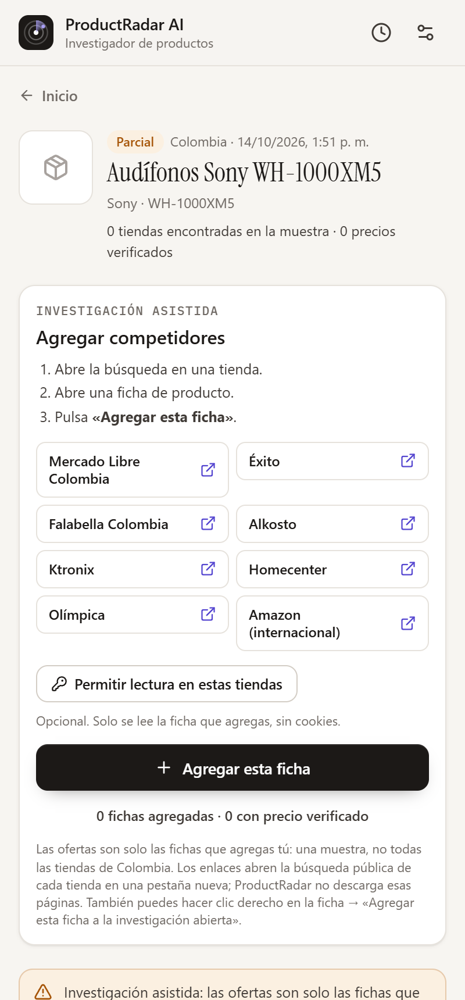

# ProductRadar AI

**Extensión de Chrome (Manifest V3) que investiga si vale la pena vender un producto.** A partir de la pestaña abierta, una URL o una foto, identifica el producto, busca quién lo vende en el país elegido y a cuánto, separa precios verificados de los que solo aparecen en el buscador, consulta referencias públicas de Alibaba, enlaza las bibliotecas oficiales de anuncios y calcula el margen de contribución con tus propios supuestos.

> «Encontré este producto. ¿Ya lo venden en Colombia? ¿A cuánto? ¿Cuánta competencia pude identificar? ¿Cuánto podría ganar por unidad? ¿Vale la pena probarlo?»

Código abierto (MIT). Sin cuentas, sin tienda propia, sin Shopify. Funciona **sin claves** en modo «Investigación asistida». Todo ocurre en el panel lateral de Chrome.

| Inicio | Reporte | Calculadora |
| --- | --- | --- |
|  |  |  |

Las capturas del reporte corresponden al **modo demostración (datos ficticios)**, que siempre muestra la franja «DATOS DE DEMOSTRACIÓN».

---

## Qué hace (y qué no)

**Hace**

- Lee la ficha del producto (JSON-LD de Schema.org, Open Graph, microdatos) **solo cuando presionas «Analizar»**, en la pestaña activa o en una URL que pegues.
- Identifica productos en fotos con un modelo de visión (Claude) y te deja **corregir** nombre, marca, modelo, GTIN y atributos antes de buscar.
- **Sin claves (investigación asistida, modo predeterminado):** te da enlaces a la búsqueda pública de las tiendas grandes del país; tú abres una ficha y pulsas «Agregar esta ficha». Solo se lee esa pestaña, tras tu clic, con las mismas reglas de verificación de precios.
- Busca ofertas con una API de búsqueda oficial (Tavily, recomendada con clave gratuita, o Brave Search), descarta blogs, redes sociales y listados, y clasifica cada hallazgo como **mismo producto, variante distinta, producto parecido o no relacionado**. Por ejemplo, 50 ml no equivale a 100 ml, 128 GB no equivale a 256 GB, un paquete de 3 no equivale a 1 unidad, y un genérico no equivale al original.
- Verifica precios leyendo la ficha pública de cada tienda **con tu permiso**, sin cookies ni tu sesión.
- Calcula **mínimo, mediana y máximo solo con precios verificados, del mismo producto y en la moneda del mercado**. Los precios que solo aparecen en el buscador se muestran aparte.
- Muestra hasta 5 referencias públicas de Alibaba (rango de precio publicado y MOQ) como **precios indicativos**, nunca como costo puesto en el país.
- Enlaza Meta Ads Library y el Centro de transparencia de anuncios de Google. Los conteos de anuncios se declaran **no verificables**. Con buscador, muestra además hasta 8 **menciones públicas** del producto en Facebook, Instagram y TikTok, que **no son anuncios**.
- Calcula el **margen de contribución por pedido** (no la utilidad neta), el CPA máximo de equilibrio y tres escenarios editables.
- Emite un veredicto con reglas interpretables («Interesante para probar», «Precaución», «No recomendable bajo estos supuestos», «Datos insuficientes») y, por separado, la **confianza de la evidencia**.
- Guarda el historial **solo en tu navegador** y exporta a JSON, CSV y una versión imprimible (o PDF).

**No hace**

- No afirma haber revisado «todas las tiendas del país»: reporta las **tiendas encontradas en la muestra**.
- No inventa precios, costos, conteos de anuncios ni rentabilidad. No promete ganancias.
- No elude inicios de sesión, captchas ni bloqueos. Una página bloqueada se marca como «no verificable».
- No descarga páginas de resultados de Google, Bing ni de las tiendas: en investigación asistida solo te da el enlace y tú abres la búsqueda.
- No recolecta historial de navegación, cookies, contraseñas ni datos de checkout.
- No incluye claves de API en el paquete distribuido.

## Qué funciona con datos reales, qué requiere claves y qué es simulado

| Función | Investigación asistida (sin claves, predeterminada) | Con gateway o claves |
| --- | --- | --- |
| Analizar la pestaña o una URL (identificación) | ✅ Real (lee la página) | ✅ |
| Identificar por foto | — (requiere visión) | ✅ Real (Anthropic Claude) |
| Buscar competidores | ✅ Real, **manual**: enlaces a la búsqueda de cada tienda; tú agregas las fichas | ✅ Real, automática (Tavily o Brave Search API) |
| Verificar precios en fichas | ✅ Real (solo las fichas que agregas) | ✅ Real (lectura directa desde tu navegador, con permiso) |
| Referencias de Alibaba | Enlace a la búsqueda de Alibaba (las revisas tú) | ✅ Real (búsqueda web restringida a alibaba.com) |
| Enlaces a bibliotecas de anuncios | ✅ (sin conteos) | ✅ (sin conteos) |
| Menciones públicas en redes (no son anuncios) | — | ✅ Real (hasta 8, del buscador) |
| Calculadora, escenarios, veredicto, exportación | ✅ | ✅ |
| **Demostración** | ✅ **Ficticia** y marcada en toda la interfaz | ✅ |

## Instalación (carga manual, para probar)

Requisitos: Node.js 22.12 o superior, pnpm 10 y Chrome 116 o superior.

```bash
pnpm install
pnpm build            # genera apps/extension/.output/chrome-mv3
pnpm zip              # genera apps/extension/.output/productradar-ai-0.1.0-chrome.zip
```

1. Abre `chrome://extensions` y activa el **Modo de desarrollador**.
2. Pulsa **Cargar descomprimida** y elige `apps/extension/.output/chrome-mv3`.
3. Fija el ícono de ProductRadar AI. Al pulsarlo se abre el **panel lateral**.
4. Sin configurar nada (si compilaste sin `WXT_GATEWAY_URL`), la extensión arranca en **Investigación asistida**: identifica el producto, confirma y agrega fichas desde las tiendas (ver [Uso](#uso)). También puedes pulsar **«Abrir demostración (datos ficticios)»**.

## Configuración

ProductRadar admite tres modos (en ⚙ Configuración): «Investigación asistida» (sin claves), «Claves propias» y «Servicio ProductRadar». Para búsqueda automática en internet, lo más rápido es una **clave gratuita de Tavily** (B).

### A. Investigación asistida (sin claves, predeterminada)

Es el modo inicial si compilas sin `WXT_GATEWAY_URL`. No usa buscador ni IA, ni necesita cuentas o claves. Al confirmar el producto, «Buscar en tiendas de Colombia» crea el reporte **al instante y sin conexiones de red**, con enlaces a la búsqueda pública de cada tienda. Tú abres la ficha que te interese y pulsas «Agregar esta ficha»: solo se lee esa pestaña. La cobertura son las fichas que agregas (una muestra) y nunca se inventan ofertas.

Tiendas enlazadas en Colombia: Mercado Libre, Éxito, Falabella, Alkosto, Ktronix, Homecenter, Olímpica y Amazon (internacional). México, Perú y Chile tienen sus propias tiendas (enlaces sin verificar).

Por qué no hay búsqueda automática sin claves: ver [docs/limitations.md](docs/limitations.md). Si antes guardaste «Servicio ProductRadar» sin URL, verás «Configuración pendiente»: elige «Investigación asistida» y pulsa **Guardar**.



### B. Clave gratuita de Tavily (sin tarjeta) — recomendada para búsqueda automática

1. Crea una cuenta en <https://tavily.com> (el panel está en app.tavily.com).
2. Copia tu clave (empieza por `tvly-`).
3. En ProductRadar: ⚙ Configuración → «Claves propias» → Buscador: **Tavily** → pega la clave → **Guardar**. Acepta el permiso para `api.tavily.com`.

El plan gratuito «Researcher» trae 1.000 créditos al mes y no pide tarjeta (según Tavily; confírmalo al registrarte). Cada investigación usa unos 5–8 créditos, así que alcanza para unas 125–200 investigaciones al mes (estimación).

Es el modo «Claves propias», **solo para uso personal**. El selector «Buscador» también ofrece **Brave Search** (requiere un plan de Brave; ver costos), y solo se muestra el campo de clave del buscador elegido. Si ese buscador no tiene clave pero el otro sí, se usa el otro (quien ya tenía Brave sigue funcionando). La clave de Anthropic es opcional (identificación por foto). Por defecto las claves se guardan en `chrome.storage.session` (se borran al cerrar Chrome). **Guardar claves en una extensión no las protege** de quien tenga acceso al equipo: no uses este modo para distribuir.

### C. Servicio ProductRadar (gateway) — para distribuir

Un Cloudflare Worker mínimo (`apps/gateway`) guarda las claves del buscador (Tavily o Brave) y de Anthropic fuera de la extensión, aplica límites de frecuencia y presupuesto diario, y **nunca descarga URLs arbitrarias**. Despliega el tuyo:

```bash
cd apps/gateway
npx wrangler secret put TAVILY_API_KEY     # o BRAVE_API_KEY (basta con un buscador)
npx wrangler secret put ANTHROPIC_API_KEY  # opcional: identificación por foto
npx wrangler secret put ACCESS_CODE        # opcional
# Edita wrangler.jsonc → ALLOWED_ORIGINS = "chrome-extension://<id de tu extensión>"
#                       SEARCH_PROVIDER = "tavily" o "brave" (opcional)
pnpm gateway:deploy
```

Sin `SEARCH_PROVIDER`, el gateway usa Tavily si tiene su clave y, si no, Brave. Si eliges uno y falta su clave, no cambia al otro: `/v1/health` lo indica y las búsquedas responden 503.

Luego pega la URL del Worker en Configuración → «Servicio ProductRadar» → **Probar conexión** → **Guardar**. Para incluirla en el paquete al compilar:

```bash
WXT_GATEWAY_URL=https://productradar-gateway.<tu-cuenta>.workers.dev pnpm build
```

Más detalles en [apps/gateway/README.md](apps/gateway/README.md).

## Uso

### Con búsqueda automática (gateway o claves)

1. Abre una ficha de producto y pulsa el ícono → **Analizar esta página**. También puedes usar clic derecho → *Investigar este producto con ProductRadar*, el atajo `Alt+Shift+P`, pegar una URL o subir una foto.
2. **Confirma o corrige** el producto: nombre, marca, modelo, GTIN y atributos. Elige el país.
3. **Buscar competencia**: verás el progreso por etapas y los hallazgos parciales. Chrome te pedirá permiso **una vez** para leer las fichas públicas encontradas. Puedes negarlo y seguir solo con datos del buscador.
4. En el reporte: corrige coincidencias («Marcar coincidencia exacta», «Excluir de comparación»), introduce tu **precio y costo**, el CPA y las devoluciones, y observa cómo cambian el margen y el veredicto.
5. Exporta a JSON o CSV, o imprime o guarda como PDF.

### Investigación asistida (sin claves)

1. Identifica el producto con **Analizar esta página**, una URL o «¿Ya sabes qué producto es? Escríbelo tú mismo». Confirma marca y modelo (con ellos se arman los enlaces de búsqueda) y elige el país.
2. Pulsa **«Buscar en tiendas de Colombia»** (o del país elegido). El reporte se crea al instante como «Parcial», sin ofertas y con veredicto «Datos insuficientes».
3. En la tarjeta **«Agregar competidores»**, pulsa **«Permitir lectura en estas tiendas»** (opcional; solo pide los dominios de esas tiendas). Abre la búsqueda de una tienda (se abre en una pestaña nueva) y entra a la ficha de un producto.
4. Pulsa **«Agregar esta ficha»** en el panel. Sin el permiso anterior, usa clic derecho en la ficha → *Agregar esta ficha a la investigación abierta*. El contador muestra «N fichas agregadas · M con precio verificado». Volver a agregar la misma URL la reemplaza; las páginas de resultados, de inicio y de Alibaba se rechazan.
5. Repite con otras tiendas, introduce tu **precio y costo** en la calculadora y revisa el veredicto y la confianza. Para proveedores, usa el enlace **«Buscar en Alibaba»** (precios indicativos).

## Costos de terceros (verifica los precios vigentes)

| Servicio | Uso por investigación | Referencia de precio (octubre de 2026) |
| --- | --- | --- |
| Tavily Search API (recomendado) | 3–6 consultas de mercado + 1 de Alibaba + 1 de menciones en redes: unos 5–8 créditos | Plan gratuito «Researcher»: 1.000 créditos al mes, sin tarjeta según Tavily. Una búsqueda básica = 1 crédito. Pago por uso: US$0,008 por crédito. |
| Brave Search API | 3–6 consultas de mercado + 1 de Alibaba + 1 de menciones en redes | Plan *Search*: ~US$5 por 1.000 solicitudes, con US$5 de crédito mensual. Brave retiró su plan gratuito en 2026 según fuentes de terceros; confirma en su panel. |
| Anthropic Claude (visión) | 1 llamada por foto (máx. 1280 px, esfuerzo bajo) | `claude-opus-5-5`: US$4 / US$20 por millón de tokens de entrada / salida. Estimación: unos centavos de dólar por foto. |
| Cloudflare Workers | 1 solicitud por consulta | Plan gratuito suficiente para pruebas. |

Con el plan gratuito de Tavily, una investigación no cuesta dinero mientras te queden créditos (unas 125–200 al mes, estimación). Con Brave o con el pago por uso de Tavily cuesta del orden de **US$0,03–0,06** en búsquedas, más la foto si la usas. El gateway trae límites diarios configurables (`DAILY_SEARCH_LIMIT`, `DAILY_VISION_LIMIT`). La investigación asistida no usa servicios de terceros: no tiene costo.

## Limitaciones importantes

- **Cobertura de búsqueda:** Brave no admite `country=CO` ni `PE`, así que para esos mercados se busca en español con el país en la consulta. El parámetro `country` de Tavily solo **prioriza** resultados del país, no los filtra. En ambos casos se filtran después las señales locales, y la muestra **no** representa todo el mercado.
- **Investigación asistida:** la cobertura son solo las fichas que agregas. Si una ficha publica varios precios del mismo artículo (varios vendedores, o precio normal y de oferta, como Éxito y Falabella), se verifica el más bajo disponible; si son variantes que no se pueden atar al producto, la ficha entra **sin precio verificado**.
- **Verificación:** las páginas que generan el precio solo con JavaScript, sin datos estructurados, o que bloquean la lectura automática quedan como «no verificables».
- **Publicidad:** no existe una fuente pública que cuente todos los anuncios de un país (para Colombia, la API de Meta solo expone anuncios políticos o de temas sociales). Se ofrecen enlaces a las bibliotecas oficiales y, con buscador, menciones públicas en redes, que **no** prueban que haya una campaña.
- **Alibaba:** precios indicativos tomados del buscador, sin flete, aranceles ni IVA. El tipo de cambio siempre lo introduces tú, con fecha y fuente.
- **Coincidencias:** las reglas son deterministas y conservadoras, pero no infalibles. Revisa y corrige manualmente.

Ver [docs/limitations.md](docs/limitations.md).

## Desarrollo

```bash
pnpm dev               # extensión con recarga en caliente (WXT)
pnpm test              # pruebas unitarias (core, gateway, extensión)
pnpm typecheck         # TypeScript estricto en todos los paquetes
pnpm lint              # ESLint (incluye reglas contra eval y HTML externo)
pnpm e2e               # prueba de humo en Chromium con la demo (requiere pnpm build)
pnpm e2e:gateway       # extensión ↔ gateway local sin claves (Caso D)
pnpm check:release     # manifiesto, código remoto, credenciales, ZIP
pnpm verify            # todo lo anterior salvo E2E
pnpm build:edge        # variante para Microsoft Edge (sin probar)
```

Para las pruebas E2E: `npx playwright install chromium`.

### Estructura

```text
apps/extension     Extensión Chrome (WXT + React + TypeScript + Tailwind)
apps/gateway       Cloudflare Worker opcional (búsqueda e IA con claves del servidor)
packages/core      Lógica pura: tipos Zod, normalización, coincidencias, precios,
                   finanzas, veredicto, extracción, proveedores y exportación
fixtures/          Datos de DEMOSTRACIÓN ficticios (explicitly-demo-data.json)
docs/              Arquitectura, privacidad, limitaciones, demo, publicación
scripts/           Íconos, fixture de demo, E2E y verificación de publicación
```

## Documentación

- [Arquitectura](docs/architecture.md)
- [Privacidad](docs/privacy.md) (base para la política de Chrome Web Store)
- [Limitaciones](docs/limitations.md)
- [Guion de demo (2–3 min)](docs/demo.md)
- [Publicación en Chrome Web Store](docs/publishing.md)
- [Cómo contribuir](CONTRIBUTING.md)

## Licencia

[MIT](LICENSE). ProductRadar AI es un nombre provisional: verifica su disponibilidad antes de publicar.
